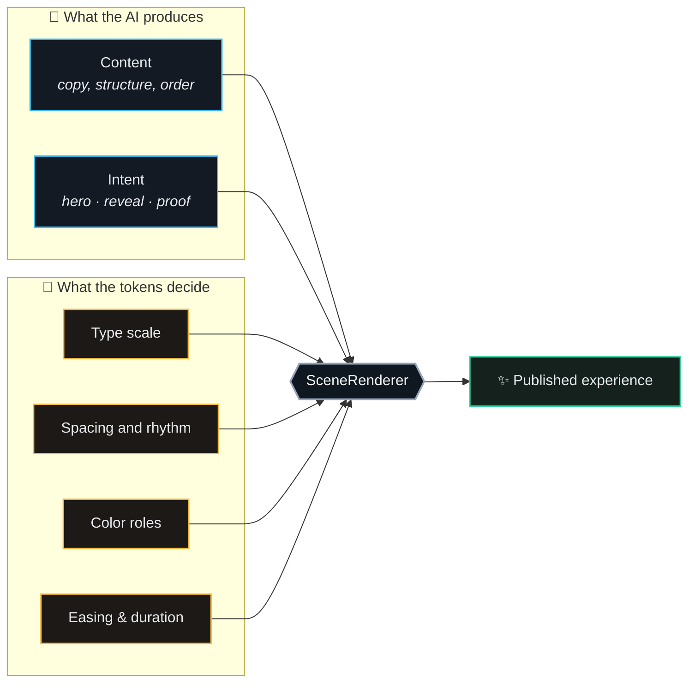
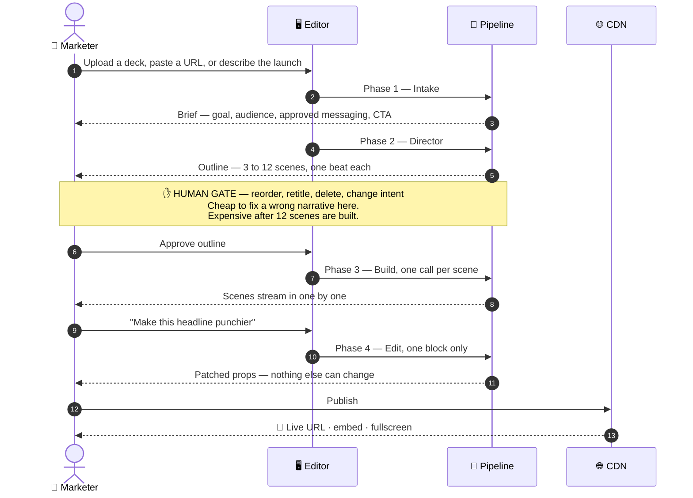
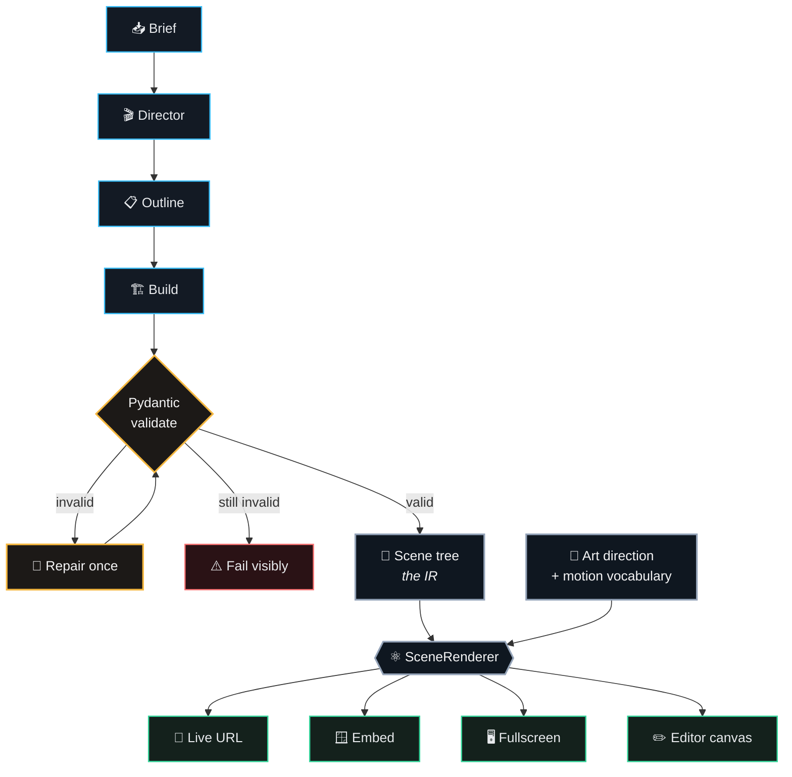
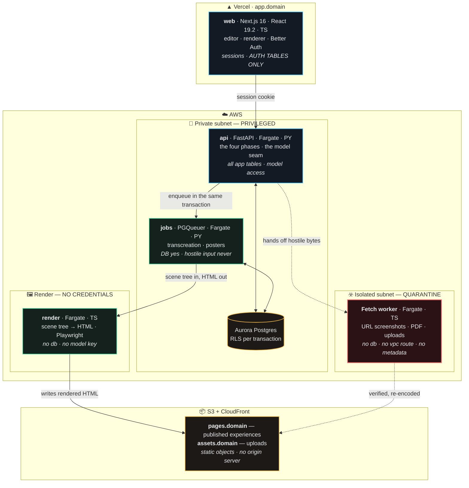
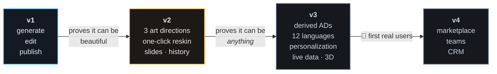

<div align="center">

# ✦ d-design

### AI presentation-experience engine

**Brief in, immersive scrolling experience out** — published as a URL, an embed, or fullscreen.

*The AI emits content and intent. It never writes styling.*

<br/>


<br/><br/>

[**Read the spec**](docs/README.md) · [The bet](#-the-bet) · [Architecture](#-architecture) · [User flow](#-user-flow) · [Cloud](#-cloud-architecture) · [Roadmap](#-roadmap)

</div>

<br/>

> [!NOTE]
> **v1 is built and its acceptance run passes.** A prompt becomes a Brief, an editable outline, streamed scenes, an experience you edit two ways and publish — presented fullscreen or embedded. **Two art directions ship**, which is the falsification test v1's own Risk 4 demanded: the same scene tree renders as a black cinematic stage and as a printed editorial spread, one switch apart, with no branch in the renderer.
>
> `docs/` is the specification — 84 documents, ~13,000 lines, covering the product, the stack, the threat model, and the rules the code must follow. Start at [`docs/README.md`](docs/README.md); build status lives in [`docs/v1/plan/README.md`](docs/v1/plan/README.md) and the next release is planned in [`docs/v2/plan/README.md`](docs/v2/plan/README.md).

---

## 🎯 The problem

Presentation tooling splits into two useless halves.

<table>
<tr>
<td width="50%" valign="top">

### 🧊 Template tools
*Gamma, Beautiful.ai, Canva*

Generate content **into** fixed layouts. They make presentations faster, not better. Every deck shares a skeleton — and the skeleton is visible.

</td>
<td width="50%" valign="top">

### 🧨 Coding agents
*Artifacts, v0, Lovable*

Generate working HTML with no narrative sense and **no answer to the second prompt**. Once 2,000 lines exist, *"make that headline smaller"* means a regeneration that destroys what you liked.

</td>
</tr>
</table>

Nothing turns an idea into an immersive presentation experience that **stays editable**.

---

## ✦ The bet

The AI never writes styling. It emits **content + intent** — `motion: "reveal"`, `emphasis: "hero"` — and a separate **art-direction layer** resolves that intent into type scale, spacing, color, easing, and duration.



That single constraint buys four things at once:

| | It buys | Because |
|:--:|---|---|
| 🎨 | **Consistent design quality** | The AI cannot pick a bad font size — it never sees one |
| ✏️ | **Safe editing** | Output is a typed tree, so an edit patches one block instead of regenerating HTML |
| 🔒 | **A real product boundary** | Custom code runs in a sandboxed iframe with no network and no storage |
| ♻️ | **Cheap variety** | Art direction #2 is a token file, not a rewrite |

> [!IMPORTANT]
> Without this constraint, the product is Claude Artifacts — which already generates a beautiful HTML presentation for free, and already falls apart on the second edit.

### What that looks like in practice

```jsonc
// ✅ A block the AI emits — meaning only
{
  "type": "Headline",
  "props": { "text": "Ship in minutes, not weeks", "emphasis": "hero" },
  "motion": "reveal"
}

// ❌ The schema has no field for any of this
{ "fontSize": "4rem", "color": "#F4F4F5", "duration": "900ms", "ease": "expo-out" }
```

The invariant is **checkable, and it is checked**: a test walks every block in a generated tree and fails on anything matching `/#[0-9a-f]{3,8}|[\d.]+(px|rem|em|ms|s)\b/i`.

---

## 🔄 User flow

Four AI phases, **one human gate**, and edits that cost ~1% of a regeneration.



<div align="center">

| Phase | In → Out | Cost |
|---|---|:--:|
| **Intake** | conversation / document / URL → `Brief` | ~$0.05 |
| **Director** | `Brief` → `Outline` | ~$0.03 |
| **Build** | per scene → `Scene` JSON *(streamed)* | ~$0.14 cached |
| **Edit** | block + instruction → `Partial<BlockProps>` | ~$0.01 |

**≈ $0.20 per experience** · ≈ $0.40 with the visual verification loop

</div>

> [!TIP]
> Token cost is **not** the constraint on this product. Imagery, storage, bandwidth, and human review time all exceed it — which is why pricing was safely deferred to v3.

---

## 🏛 Architecture

Every AI output is Pydantic-validated. Invalid → one repair retry → then it fails visibly. **A compromised model can only cause a rejected generation.**



**One renderer, four surfaces.** The editor canvas, the published page, the embed, and fullscreen are all the same React tree — so there is no drift between what you edit and what ships.

### The scene tree

```python
class Experience(BaseModel):  # id, title, mode, brand, art_direction, scenes  — 3–12 scenes
class Scene(BaseModel):       # id, intent, layout, blocks                     — 1–8 blocks
class Block(BaseModel):       # id, type, region?, props, motion?
```

Pydantic is the source of truth. TypeScript types and a Zod validator are **generated** from it, so the renderer and the pipeline cannot disagree about the shape.

<div align="center">

| | v1 | v2 | v3 |
|---|:--:|:--:|:--:|
| **Block types** | 11 | 18 | 19 |
| **Layouts** | 6 | 6 | 6 |
| **Scene intents** | 5 | 5 | 5 |
| **Art directions** | 1 | 3 | 3 + derived |
| **Motion vocabularies** | 1 | 4 | 4 |

</div>

### Art direction — the differentiator

Same scene tree, unrecognizably different output. **The proof is that AD #2 requires zero renderer changes.**

| Art direction | Ground | Character | Headline budget | Default motion |
|---|---|---|:--:|---|
| 🌑 **cinematic-dark** | `#08090B` near-black | Large light type, grain, glow | **60** | `cinematic-slow` |
| 📰 **editorial-light** | `#FBFAF8` warm off-white | Serif display, hairline rules, no texture | **80** | `editorial-restrained` |
| 🟥 **bold-brutalist** | brand color, full strength | Oversized type, hard blocks, extreme contrast | **34** | `mechanical-snap` |

> [!NOTE]
> **Character budgets are per art direction, and that is the honest crack in the thesis.** Content is independent of *most* styling, and the residue is character count. The design response is to surface the coupling rather than hide it — a reskin flags overflow and never silently rewrites approved marketing copy.

---

## 🌐 Cloud architecture

**Three origins, five runtimes, two languages.** Most splits are *trust boundaries*; one is a *language boundary*, and it is labelled so it is never mistaken for a security control.



### Why two workers

> [!WARNING]
> One process doing both jobs is the exact combination the isolation exists to prevent: **the thing holding database credentials would also be the thing parsing an attacker's PDF and rendering an attacker's webpage.**

| | Job worker | Fetch worker |
|---|---|---|
| **Holds** | DB credentials, model keys | One integration token, in active use |
| **Parses** | Rows from your own database | PDFs, images, 3D models, attacker-chosen URLs |
| **Network** | Private subnet | Egress only — no route to the VPC, no metadata endpoint |
| **If breached** | Serious | It has nothing worth stealing |

The isolation is a **subnet and a security group in Terraform**, not a sentence in a document — and the test that proves it is a network test: from inside the fetch worker, the metadata IP is unreachable at the socket level.

### Published pages have no origin server

Publishing renders the scene tree to HTML and writes it to S3. There is no route to attack, no database to reach, and no cache-key disagreement between a CDN and an origin — **because there is no origin.** A viral launch page costs pennies and cannot exhaust a connection pool.

---

## 🧰 Tech stack

<div align="center">


</div>

| Layer | Choice | Note |
|---|---|---|
| 🧠 **Model access** | **No preferred vendor** — one seam, OpenRouter behind it | Any model named today is wrong in two quarters. Build the switching apparatus, not the conviction |
| 🤖 **Agent framework** | **None** | Four deterministic phases with a human gate is not an agent — your code makes every next-step decision. And it would be a privileged dependency in a class under active exploitation in 2026 |
| 🐍 **Backend** | **Python** · FastAPI · SQLAlchemy + Alembic | Pydantic owns the `Scene` schema; TypeScript types and a Zod validator are generated from it |
| ⚛️ **App** | Next.js 16 App Router · React 19.2 · Zustand · shadcn/ui | Tailwind on app chrome only — never the art direction |
| 🎞️ **Motion** | Motion (`motion/react`) | Not `framer-motion` — renamed in 2025 |
| 🗄️ **Data** | Postgres · SQLAlchemy · RLS via a session variable | Every tenant query goes through a tenant wrapper — there are exactly two, one per language |
| 🔑 **Auth** | Better Auth, kept in Node, users in your own Postgres | Ships MFA, passkeys, orgs, verification — Python has no equivalent |
| ⚙️ **Jobs** | PGQueuer on the same Postgres | Jobs enqueue in the same transaction as the data change |
| 🚀 **Hosting** | Vercel · ECS Fargate ×4 · S3 + CloudFront | Split on trust — except `render`, which is split on language |
| 🧪 **Quality** | pytest · Vitest · Playwright · Promptfoo evals | Structural evals gate; a probabilistic judge never does |

> [!TIP]
> **v1 needs none of this.** Docker Compose and two dev servers — no AWS account, no auth, no workers, no CDN. The whole operational stack lands in v3, the release that has real users.

---

## 📚 Documentation

**[`docs/README.md`](docs/README.md) is the index.** It routes to every directory, and each directory's README routes to every file — so you get from a question to the exact document in **two hops**.

<table>
<tr><th align="left">Directory</th><th align="left">Kind</th><th align="left">What it covers</th><th align="center">Docs</th></tr>
<tr><td>📘 <a href="docs/v1/README.md"><b>v1</b></a></td><td><i>versioned</i></td><td>Generate, edit, publish — <b>shipped</b>. Includes the twelve-phase build plan</td><td align="center">20</td></tr>
<tr><td>📗 <a href="docs/v2/README.md"><b>v2</b></a></td><td><i>versioned</i></td><td>Creative range — same content, radically different experiences. Includes the thirteen-phase plan</td><td align="center">19</td></tr>
<tr><td>📙 <a href="docs/v3/README.md"><b>v3</b></a></td><td><i>versioned</i></td><td>Derived, personalized, live, multilingual, dimensional</td><td align="center">8</td></tr>
<tr><td>🧰 <a href="docs/techstack/README.md"><b>techstack</b></a></td><td><b>current</b></td><td>Where every piece runs, which model, what the AI may call</td><td align="center">7</td></tr>
<tr><td>🛡️ <a href="docs/security/README.md"><b>security</b></a></td><td><b>current</b></td><td>Threat model and every control, gated to the version that needs it</td><td align="center">12</td></tr>
<tr><td>📐 <a href="docs/coderules/README.md"><b>coderules</b></a></td><td><b>current</b></td><td>How the code stays consistent when an AI writes most of it</td><td align="center">9</td></tr>
</table>

Version directories record **what was believed at the time**; the cross-cutting ones are kept current. Where they disagree, the cross-cutting ones win — and [`docs/techstack/decisions.md`](docs/techstack/decisions.md) lists every supersession.

> [!IMPORTANT]
> **Read [`docs/v1/scene-schema.md`](docs/v1/scene-schema.md) first.** Everything else depends on that shape.

---

## 🗺 Roadmap



| | Focus | Why then |
|---|---|---|
| **v1** ✅ | Generate, edit, publish — and, in the end, *two* art directions | Proved the runtime, the editing model, and that the output can be beautiful. The second art direction was built the day the acceptance run passed, because Risk 4 said the layer was unproven until there were two |
| **v2** | 3 ADs, motion as its own axis, reskin, slides, history | The abstraction is unproven with one AD. Reskin is what makes it visible to users |
| **v3** | AI-derived ADs, personalization, analytics, localization, live data, 3D, pricing | The wow release — and the first one real users see |
| **v4** | Marketplace, CRM integrations, teams and roles | All gated on users who exist by then |
| **later** | Charts · PDF/PPTX export · speaker notes · collaboration · freeform canvas | Each is a product inside the product |

> [!CAUTION]
> **Users arrive after v3 — that is the project's top risk.** v1 and v2 assumptions compound unvalidated for the entire build. The *bets* tables in [`v2/spec.md`](docs/v2/spec.md) and [`v3/spec.md`](docs/v3/spec.md) are the checklist for the day the first user shows up. The natural early exit is after v3 step 4: derived ADs plus twelve languages is already worth showing someone.

---

## ⚖️ The eleven non-negotiables

Full text in [`AGENTS.md`](AGENTS.md). The project-level hook is live today; the pre-commit gate is specified in [`coderules/tooling.md`](docs/coderules/tooling.md) and lands with the first line of code.

```
 1  Strict TS. No `any`, no `!`
 2  One schema parse per external input, at entry
 3  Expected failures return Result; only bugs throw
 4  Import across features only through their index.ts
 5  No new dependency without a ledger line
 6  renderer/ core is pure — it runs in three processes
 7  AI output carries no presentational values
 8  The ORM only in a feature data module
 9  Every tenant query goes through asUser()
10  Anything that grants, fails closed
11  The gate is green, or the commit does not land
```

> [!NOTE]
> **Rules in a file are advisory; hooks are enforcement.** `.claude/settings.json` runs `scripts/hooks/post-edit.sh` on every write and exits non-zero so the agent fixes what it just wrote, rather than discovering it at commit time.

---

## 📂 Repository

```
d-design/
├── README.md            you are here
├── AGENTS.md            the contract — 11 rules + a task→doc routing table
├── CLAUDE.md            one line: @AGENTS.md
├── docs/                the specification (47 documents)
│   ├── v1/ v2/ v3/                        versioned — what was believed at the time
│   └── techstack/ security/ coderules/    cross-cutting — kept current
├── scripts/
│   ├── check-docs.sh    every link resolves, every file is indexed
│   └── hooks/           project-level enforcement
└── .claude/settings.json
```

---

<div align="center">

### Scope, honestly

**Wedge:** marketers building product launches &nbsp;·&nbsp; **Delivery:** live URL, embed, fullscreen<br/>
**Builder:** solo, with AI assistance — so v1 shipped the smallest thing that could prove the bet, end to end

<br/>

*Gamma reached ~$100M ARR by making presentations **faster**.*<br/>
*This bets that people will pay for presentations that are **better**.*<br/>
*Tome bet the same thing and lost — [read why](docs/v1/market.md) before building.*

</div>
