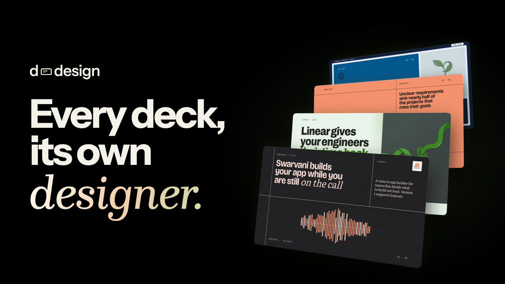
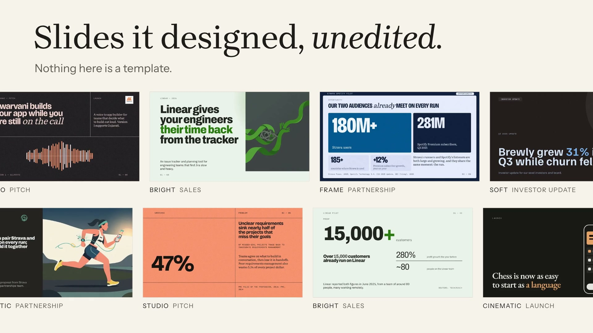
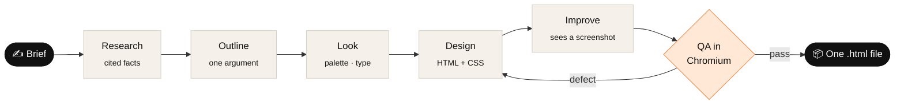
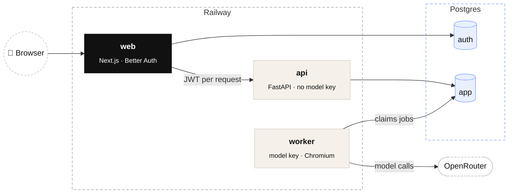

<p align="center">
  
</p>

<h1 align="center">d-design</h1>

<p align="center">
  <b>The open-source AI deck maker that designs, not templates.</b><br>
  Type a brief. Get a deck that looks made by a designer, as one offline <code>.html</code> file.
</p>

<p align="center">
  <a href="LICENSE"></a>
  <a href="https://github.com/KirtanUgreja/d-design/actions/workflows/gate.yml"></a>
  
  
  <a href="CONTRIBUTING.md"></a>
</p>

<p align="center">
  <a href="#-deploy-in-one-command">Deploy</a> ·
  <a href="#-how-it-works">How it works</a> ·
  <a href="#-pick-your-model">Models</a> ·
  <a href="#-architecture">Architecture</a> ·
  <a href="CONTRIBUTING.md">Contribute</a>
</p>

<br>

<table>
  <tr>
    <td width="33%" valign="top">
      <h3>🎨 Designed, not filled</h3>
      No templates. The model writes every slide in real HTML and CSS, inside a design system made for that deck.
    </td>
    <td width="33%" valign="top">
      <h3>🔍 Checked before you see it</h3>
      Every slide is rendered in Chromium and measured for overflow, collisions and contrast. Broken slides get fixed or flagged.
    </td>
    <td width="33%" valign="top">
      <h3>📎 Every number has a source</h3>
      Figures trace to your brief or a cited page. Anything else is held for you to approve.
    </td>
  </tr>
</table>

<p align="center">
  
</p>

## 🚀 Deploy in one command

You need a [Railway](https://railway.com) account and an [OpenRouter](https://openrouter.ai/keys) key.

```bash
git clone https://github.com/KirtanUgreja/d-design.git && cd d-design
railway login
./scripts/deploy-railway.sh
```

It asks for your key and who may sign up, then builds the databases, the three services and a public URL. Run it again to ship new code.

> [!TIP]
> **On Railway's free plan** (3 services), bring two free [Neon](https://neon.tech) databases:
> `APP_DATABASE_URL=... AUTH_DATABASE_URL=... ./scripts/deploy-railway.sh`

## ✨ How it works



<details>
<summary><b>Each step, and where it lives in the code</b></summary>

<br>

| Step | What happens | Code |
|---|---|---|
| Interview | A few targeted questions; skippable | `api/engine/content/interview.py` |
| Research | A product file and the market evidence; only quoted facts are kept | `api/engine/studio/research.py` |
| Outline | A claim per slide; every number traces to you or a source | `api/engine/studio/outline.py` |
| Look | One of 8 visual languages, a palette around your brand colour, a type pairing | `api/engine/design/` |
| Design | An art director plans the deck; a designer writes each slide | `api/engine/studio/direct.py`, `design.py` |
| Improve | A creative director critiques a screenshot and redesigns; kept only if QA agrees | `api/engine/studio/improve.py` |
| Review | The whole deck judged as one piece; the two weakest slides go back | `api/engine/studio/review.py` |
| QA | Overflow, collisions, contrast (WCAG + APCA), type size; two repairs, then a flag | `api/engine/qa/` |
| Export | Present, one offline file with zero network requests, or PDF | `api/engine/export/` |

</details>

## 🧠 Pick your model

Any [OpenRouter model](https://openrouter.ai/models) works. One variable switches them all:

```bash
MODEL=deepseek/deepseek-v4.1-flash                                         # .env, local
railway variable set --service worker MODEL=deepseek/deepseek-v4.1-flash   # Railway
```

| Variable | Sets | Default |
|---|---|---|
| `MODEL` | every text role at once | the pins below |
| `MODEL_WRITING` | research and the storyline | `anthropic/claude-sonnet-5.5` |
| `MODEL_DESIGN` | the designer and improver | `anthropic/claude-sonnet-5.5` |
| `MODEL_CHEAP` | the interview and speaker notes | `anthropic/claude-haiku-5.5` |
| `MODEL_IMAGE` | slide images (empty = off) | `google/gemini-3.1-flash-lite-image` |
| `DAILY_CAP_USD` | spend cap per user per day | `3` |

## 🏗 Architecture



- **web** is the only public service. Its `/api` proxy mints a short EdDSA JWT per request, which the browser never sees.
- **api** checks that JWT and fails closed. Another user's deck is a 404.
- **worker** has no inbound port. It alone holds the model key and the browser.

<details>
<summary><b>Run it locally</b></summary>

<br>

```bash
./scripts/setup.sh          # git hooks, Python and web deps, Chromium
cp .env.example .env        # add OPENROUTER_API_KEY and a Postgres URL
./scripts/dev.sh            # api + worker + web → http://localhost:3000
```

`web/.env.local` needs `AUTH_DATABASE_URL` and `BETTER_AUTH_SECRET`. To skip accounts: `cd api && AUTH_DISABLED=1 uv run uvicorn app:serve --factory`.

</details>

<details>
<summary><b>Tests</b></summary>

<br>

```bash
cd api && uv run pytest -q      # ~210 tests, offline: fake models, real Chromium
cd web && pnpm e2e              # sign-up, sign-in, the token proxy
./scripts/hooks/pre-commit      # the whole gate
```

The security tests call every route with no session, a forged token and another user's session.

</details>

<details>
<summary><b>Known limits</b></summary>

<br>

- One worker, so builds queue.
- Four of the eight visual languages are on, so looks repeat across many decks.
- Email and password for an allowlist; no OAuth, no reset by email.

</details>

## 🤝 Contributing

Issues and PRs are welcome. Start with [`CONTRIBUTING.md`](CONTRIBUTING.md) and the [code guide](docs/code-guide.md). Security reports go to [`SECURITY.md`](SECURITY.md).

## 📄 License

[MIT](LICENSE). The bundled fonts keep their own SIL Open Font License.
